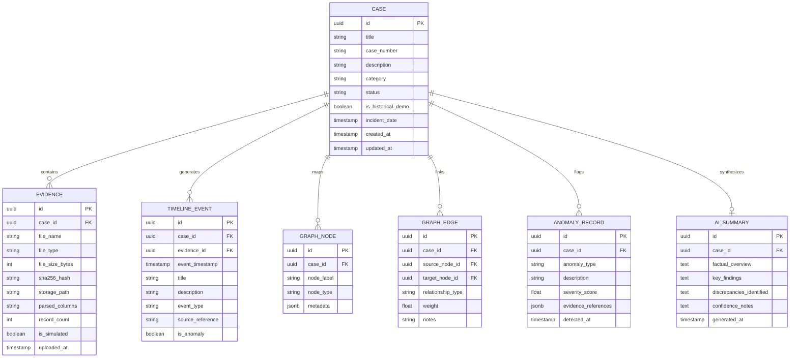

# ARCHITECTURE & SPECIFICATION

## Digital Investigation Platform with AI

This document outlines the architectural specifications, communication mechanisms, data models, API contracts, design system, and forensic integrity guardrails.

---

## 1. High-Level Architecture & Communication Protocol

The platform employs a decoupled **Distributed Architecture across 4 Independent Modules**:

```
[1. frontend-javafx (JavaFX 21)]
       │
       │ HTTP / JSON (Port 8080)
       ▼
[2. backend (Spring Boot 3.x)] ─── JPA / JDBC ───▶ [PostgreSQL Database (Port 5432)]
       │                      ▲
       │                      │ Internal Engine Dependency
       │             [3. evidence-processing (Java 21 Engine)]
       │
       │ HTTP / JSON (Port 8000)
       ▼
[4. ai-service (Python Microservice)]
```

### Module Structure:
1. **`frontend-javafx/`**: Desktop user interface built with Java 21 + JavaFX, featuring the 7 permanent navigation sections and dark cyber-forensic design.
2. **`backend/`**: Spring Boot REST API orchestrating case workflows, relational storage, and microservice bridges.
3. **`evidence-processing/`**: Dedicated, independent Java 21 evidence processing library (RFC 4180 CSV parsing, Java Collections, Generics, `java.time`, and SHA-256 cryptographic chain of custody).
4. **`ai-service/`**: Python microservice running FastAPI, Isolation Forest, Z-score analysis, and evidence-grounded summary generation.
5. **`data/`**: Dedicated strictly for runtime storage (`data/uploads/` and historical benchmark files in `data/samples/`).

### Communication Flow:
1. **Frontend to Backend**:
   - The JavaFX desktop application issues asynchronous, non-blocking requests using Java 21's native `java.net.http.HttpClient` with `CompletableFuture`.
   - UI thread is never blocked; responses are parsed via `Jackson` and dispatched back to the JavaFX Application Thread via `Platform.runLater()`.
   - The frontend communicates **strictly** with the Spring Boot Backend on `http://localhost:8080/api`.

2. **Backend to Database**:
   - Spring Boot uses Spring Data JPA / Hibernate connected via HikariCP to PostgreSQL.
   - For development convenience, an automatic fallback/profile (`dev`) can operate with an embedded H2 database or local PostgreSQL instance.

3. **Backend to Python AI Service**:
   - When an investigator triggers **Anomaly Detection** or **AI Summary Generation**, the Spring Boot backend collects the case metadata, parsed evidence rows, and timeline events.
   - Spring Boot performs an internal REST POST call to the Python service at `http://localhost:8000/api/v1/...`.
   - The Python service returns structured JSON containing anomaly scores, flagged indices, and grounded case summaries.
   - The backend persists the results into the PostgreSQL database, and forwards the clean response back to the JavaFX client.

---

## 2. Main Data Models & Database Schema

### Entity-Relationship Diagram



### Enumerations:
- `CaseStatus`: `ACTIVE`, `UNDER_REVIEW`, `CLOSED`, `ARCHIVED`
- `CaseCategory`: `FINANCIAL_FRAUD`, `HEIST_THEFT`, `INDUSTRIAL_DISASTER`, `KIDNAPPING_ABDUCTION`, `CYBER_INCIDENT`, `GENERAL_FORENSIC`
- `NodeType`: `PERSON`, `ORGANIZATION`, `BANK_ACCOUNT`, `LOCATION`, `VEHICLE`, `EVIDENCE_OBJECT`
- `AnomalyType`: `TIMESTAMP_OUT_OF_SEQUENCE`, `FINANCIAL_SPIKE`, `COMMUNICATION_CLUSTER`, `RECORD_MISMATCH`, `ROUTING_DEVIATION`

---

## 3. REST API Specification

All backend endpoints use the `/api` prefix. Standard response envelopes use `ApiResponse<T>`.

### Case Endpoints
- `GET /api/cases`: Retrieve list of all cases (supports query params `?category=...&status=...`).
- `GET /api/cases/{id}`: Retrieve detailed case profile with metrics.
- `POST /api/cases`: Create a new investigation case.
- `PUT /api/cases/{id}`: Update case information.
- `DELETE /api/cases/{id}`: Delete a case and associated records.

### Evidence Endpoints
- `GET /api/cases/{caseId}/evidence`: List all evidence files associated with a case.
- `POST /api/cases/{caseId}/evidence/upload`: Upload an evidence file (multipart CSV/JSON/TXT) with automatic SHA-256 computation and parsing.
- `GET /api/evidence/{id}/preview`: Fetch paginated rows of parsed evidence data.
- `DELETE /api/evidence/{id}`: Remove an evidence record.

### Timeline Endpoints
- `GET /api/cases/{caseId}/timeline`: Retrieve chronological event timeline.
- `POST /api/cases/{caseId}/timeline/events`: Add a custom or extracted timeline event.

### Relationship Graph Endpoints
- `GET /api/cases/{caseId}/graph`: Retrieve graph payload (`nodes: [], edges: []`) formatted for JavaFX Canvas/Graph rendering.
- `POST /api/cases/{caseId}/graph/nodes`: Add manual entity node.
- `POST /api/cases/{caseId}/graph/edges`: Add relationship edge.

### Anomaly Endpoints
- `GET /api/cases/{caseId}/anomalies`: List all flagged anomalies for the case.
- `POST /api/cases/{caseId}/anomalies/detect`: Trigger anomaly detection engine via the Python AI microservice.

### AI Summary Endpoints
- `GET /api/cases/{caseId}/summary`: Fetch latest generated AI summary.
- `POST /api/cases/{caseId}/summary/generate`: Trigger AI case synthesis from uploaded evidence and verified case records.

---

## 4. UI Design System (Futuristic Dark Cyber-Forensic Theme)

### Color Palette

| Token | Hex Value | Usage |
|---|---|---|
| `--bg-base` | `#080b11` | Root application background (ultra-deep navy/black) |
| `--bg-surface` | `#0f172a` | Card surfaces, sidebar panels, table containers |
| `--bg-surface-elevated`| `#1e293b` | Hover states, active tabs, modal dialogs |
| `--border-subtle` | `#334155` | Card borders, dividers, subtle separators |
| `--accent-cyan` | `#00e5ff` | Primary action buttons, selection indicators, graph focus |
| `--accent-blue` | `#38bdf8` | Secondary badges, timeline points, category tags |
| `--accent-purple` | `#818cf8` | AI summary highlights, entity node links |
| `--accent-warning` | `#f59e0b` | Medium severity anomalies, missing data flags |
| `--accent-danger` | `#ef4444` | High severity anomalies, delete actions, errors |
| `--text-primary` | `#f8fafc` | Main headings, primary table data |
| `--text-secondary` | `#94a3b8` | Subtitles, labels, timestamps |
| `--text-muted` | `#64748b` | Placeholders, inactive state icons |

### Typography
- Primary UI: System San-Francisco / Segoe UI / Inter (Clean geometric sans-serif)
- Monospace / Forensics: Consolas / JetBrains Mono (For timestamps, hashes, transaction IDs)

### Layout Principles
- **Left Navigation Rail**: Permanent left sidebar with the 7 sections, collapsible labels, active glowing cyan indicator.
- **Top Context Bar**: Case selector dropdown, active case status badge, global search, and system health status.
- **Content Area**: Fluid responsive container hosting the selected view (Dashboard, Cases, Evidence, etc.).

---

## 5. Forensic AI & Integrity Guardrails

1. **Anti-Hallucination Constraints**:
   - The Python AI service uses strict prompt templates and input schemas that inject *only* the ingested evidence records and verified historical facts.
   - If an evidence file is empty or sparse, the AI must explicitly return: `"Insufficient evidentiary records to substantiate [X]."`.

2. **Fairness in Anomaly Detection**:
   - The anomaly detection models identify mathematical and statistical deviations (e.g., standard deviation outliers, timestamp inconsistencies, volume bursts).
   - Anomaly labels use neutral, factual terminology: `"Statistical Outlier"`, `"Discrepancy"`, or `"Unusual Transaction Volume"`, never `"Guilty"`, `"Fraudster"`, or `"Criminal"`.

3. **Cryptographic Integrity**:
   - Every file uploaded to the Evidence repository is hashed with SHA-256 immediately upon arrival.
   - Hashes are immutably logged with the evidence record to guarantee chain of custody.
