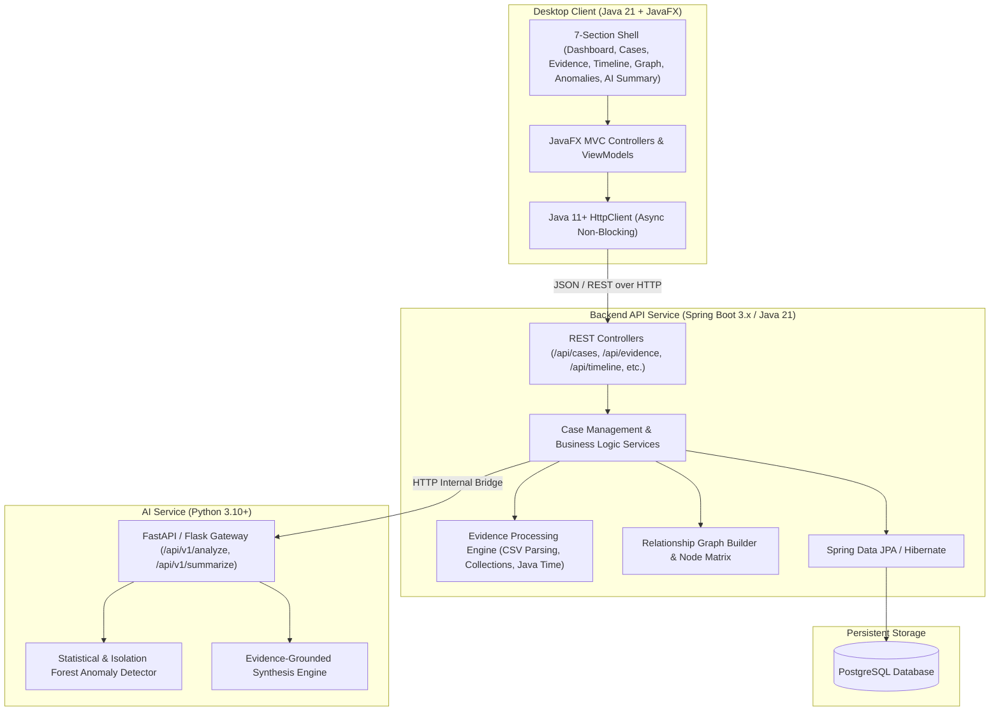

# DIGITAL INVESTIGATION PLATFORM WITH AI

A modern, professional desktop investigation platform built for forensic analysts, compliance investigators, and researchers.

---

## 📌 Executive Overview

The **Digital Investigation Platform with AI** combines:
- **Desktop UI**: Java 21 + JavaFX with a futuristic dark aesthetic (deep navy/black and electric cyan accents).
- **Backend API**: Spring Boot REST microservice running Java 21 with modular evidence processing engines.
- **Database**: PostgreSQL for persistent case records, evidence metadata, timeline events, entity relationships, and anomaly logs.
- **AI Intelligence Service**: Python service providing grounded anomaly detection and factual case synthesis.

---

## 🏛️ System Architecture



---

## 🗂️ The 7 Core Navigation Sections

The application user interface strictly adheres to seven permanent navigation views:

| # | Section | Purpose |
|---|---|---|
| 1 | **Dashboard** | High-level investigation overview: active cases, evidence counter, critical anomaly alerts, recent activity feed, and quick-action shortcuts. |
| 2 | **Cases** | Case manager: create new investigations, browse preloaded historical cases, edit case details, update statuses, or delete closed cases. |
| 3 | **Evidence** | Evidence repository: upload raw evidence (CSV logs, financial transfers, telecom records, manifests), preview entries, inspect parsed schemas, and view integrity hashes (SHA-256). |
| 4 | **Timeline** | Chronological event sequencing using Java Time: zoomable timeline showing cross-evidence timestamped activities, chronological anomalies, and event tags. |
| 5 | **Relationship Graph** | Interactive node-link graph: persons, bank accounts, companies, locations, and vehicles connected by quantified interactions. |
| 6 | **Anomalies** | Pattern-deviation detection: out-of-order timestamp anomalies, suspicious financial spikes, routing irregularities, and behavioral outliers with transparent scoring. |
| 7 | **AI Summary** | Grounded investigative reports: factual narrative synthesized strictly from uploaded case evidence and verified facts, with clear uncertainty statements. |

---

## 🏛️ Preloaded Historical Cases

The platform includes six historical benchmark cases, pre-seeded with verified factual data and clearly designated demo evidence records:

1. **Mona Lisa Theft (1911)**: Vincenzo Peruggia's Louvre heist, timeline of custody, museum staff testimonies, and historical recovery.
2. **Lindbergh Kidnapping (1932)**: The 1932 abduction, ransom gold certificate serial number tracking, carpenter wood forensic analysis, and trial records.
3. **Harshad Mehta Securities Scam (1992)**: The Bombay Stock Exchange scam, fake bank receipts (BRs), inter-bank settlement discrepancies, and securities flow analysis.
4. **Bhopal Gas Tragedy (1984)**: Union Carbide India Limited industrial disaster, tank 610 pressure/temperature logs, maintenance deferrals, and safety lapses.
5. **Mundhra Scandal (1957)**: Independent India's first financial fraud, Life Insurance Corporation (LIC) stock purchases, fraudulent shares, and the Chagla Commission inquiry.
6. **Lufthansa Heist (1978)**: JFK International Airport cash/jewelry robbery, insider security log discrepancies, associate phone records, and timeline of events.

> **Integrity Rule**: Simulated demo records are strictly labeled as `[DEMO / SIMULATED RECORD]`. Historical facts are verified against public historical archives, and unknowns or unresolved theories are explicitly presented as unverified.

---

## 📂 Repository Directory Layout

The project is organized into exactly four independent main modules plus runtime data and documentation:

```
DIGITAL_INVESTIGATION_PLATFORM_WITH_AI/
├── frontend-javafx/                    <- Module 1: JavaFX (Java 21) Desktop Application Shell & UI
├── backend/                            <- Module 2: Spring Boot 3.x REST API Backend & PostgreSQL persistence
├── evidence-processing/                <- Module 3: Core Evidence Engine (CSV parsing, Collections, Generics, Java Time)
├── ai-service/                         <- Module 4: Python AI Microservice (Isolation Forest Anomaly Detection & Summaries)
├── data/                               <- Runtime storage (uploads & historical benchmark sample files)
│   ├── uploads/                        <- Dynamically uploaded case evidence files
│   └── samples/                        <- 6 historical benchmark case data files
└── docs/                               <- Architecture, REST API specs, and case dossiers
```

---

## 🚀 Development Phases Status

- [x] **Phase 1**: Initial Architecture, Repository Scaffolding & Specifications
- [x] **Phase 2**: Spring Boot Backend & Database Schema Setup (PostgreSQL + H2 dev profile)
- [x] **Phase 3**: Java Evidence Processing Module (CSV, Generics, SHA-256, java.time)
- [x] **Phase 4**: Python AI Service (Statistical & Isolation Forest Anomaly Detection, Grounded Summaries) + Zero-Config Embedded Gateway Fallback
- [x] **Phase 5**: JavaFX Modern Desktop Shell (Dark Theme, Navigation Rail, Dashboard, Case Management)
- [x] **Phase 6**: JavaFX Forensic Views (Drag-and-Drop Evidence Ingestion, Paginated CSV Preview, Visual Timeline Spine, Interactive Draggable Canvas Graph)
- [x] **Phase 7**: JavaFX Intelligence Views (Calibrated Anomaly Severity Meters & Grounded 4-Section AI Summary Dossier)
- [x] **Phase 8**: 6 Preloaded Historical Case Seeds, Automatic Database Seeder, System Hardening & End-to-End Verification

---

## ⚡ Quick Start: Running the Platform

### Prerequisites
- **Java**: JDK 21+ (`java -version`)
- **Maven**: 3.8+ (`mvn -version`)
- **Python**: 3.10+ (Optional: backend includes embedded statistical & synthesis fallback when Python is offline)

### Step 1: Start the Backend REST API
On Windows:
```cmd
run-backend.bat
```
Or via shell:
```bash
cd backend
mvn spring-boot:run
```
*The backend boots on port 8080 and automatically seeds all 6 historical cases into the database with verified records and simulated demo datasets.*

### Step 2: Start the JavaFX Desktop Client
In a separate terminal:
On Windows:
```cmd
run-frontend.bat
```
Or via shell:
```bash
cd frontend-javafx
mvn javafx:run
```

### Step 3 (Optional): Start the Python AI Microservice
In a separate terminal:
On Windows:
```cmd
run-ai-service.bat
```
Or via shell:
```bash
cd ai-service
pip install -r requirements.txt
uvicorn main:app --host 0.0.0.0 --port 8000
```

---

## 👥 Forensic Integrity & Ethical AI Principles

- **Zero Mocking of AI**: The Python AI service uses actual machine learning/statistical routines (Isolation Forest, Z-score analysis, frequency clustering) with an embedded Median Absolute Deviation (MAD) mathematical fallback in the backend.
- **Forensic Guardrails**: AI summaries strictly disclaim unverified assertions, do not accuse individuals without adjudicated evidence, and explicitly calibrate confidence scores.
- **Auditable Cryptographic Integrity**: SHA-256 hashing applied to every uploaded evidence file. All simulated demo records are explicitly marked with `[DEMO / SIMULATED RECORD]`.

